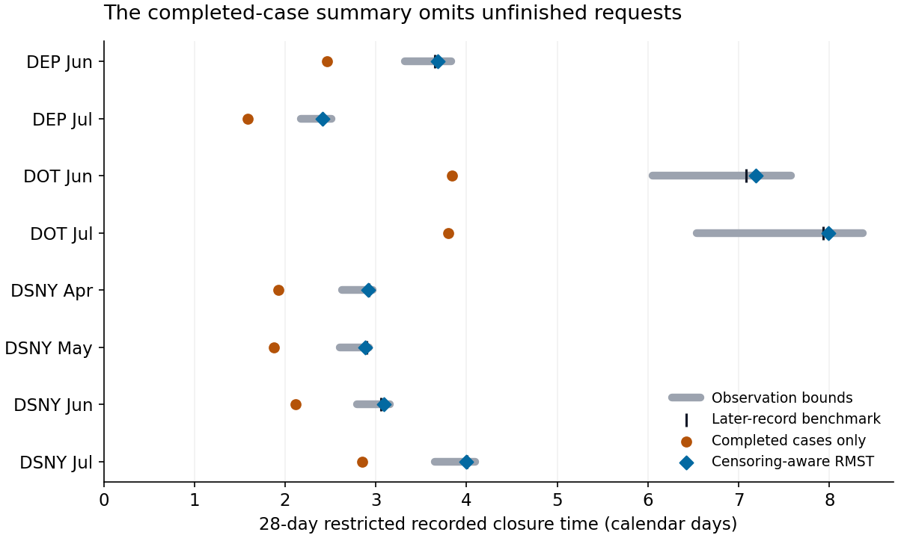

# Closure-time summaries with unfinished requests

A completed-case average can omit the unfinished part of a recent service-request cohort. This study makes that denominator choice visible with fixed NYC 311 cohorts, a restricted horizon and explicit observation bounds.

In the eight primary held panels, the censoring-aware 28-day restricted mean has an equal-panel mean absolute error of **0.033 calendar days**, compared with **1.689 days** for the fair capped completed-case summary, against a later captured-record benchmark. It is closer in all eight primary panels and all 96 held endpoint/cutoff/horizon comparisons. These results describe synthetic earlier observation rules imposed on later captured administrative records; they do not establish historical dashboard availability, true problem resolution or future performance.

**Practical use:** report cohort membership, the unfinished fraction, follow-up support, a fixed-horizon summary and observation bounds. State censoring assumptions before interpreting a product-limit estimate as performance. Dated exports and an audited closure/reopening endpoint are the next evidence needed for a prospective dashboard.

Read the [eight-page manuscript](paper/manuscript.pdf), [fixed protocol](PROTOCOL.md), [primary sources](SOURCES.md) and [reuse/privacy boundary](DATA_RIGHTS.md). All primary panels and the complete sensitivity grid are retained in [results](results/). This is AI-assisted independent research, without peer-review, deployment, causal-benefit or novel-estimator claims.



The capture includes 273,641 requests across DOT, DEP and DSNY in April–July 2026. A fixed quality gate quarantines 195 backward-date records, leaving 273,446 eligible. Four panels are development and eight held evaluation; twenty canonical dependencies were frozen publicly before held metrics. Inputs and quality counts were visible, not blinded. All 144 settings, including descriptive uncapped completed means, exact fractions, risk/censor/event counts and support/bounds, remain available.

Only aggregate timing cells are public. Request identifiers, exact timestamps, raw status strings and minimized response originals remain outside Git. Locations, problem types and narratives were not requested. The independent source certificate binds the public aggregates to complete private-original reconciliation. Public offline replay cannot inspect those unpublished identifiers and timestamps.

## Reproduce

Python 3.10; pinned dependencies. After installation, replay needs no network or private source originals.

```text
python -m pip install -r requirements.txt
python -m unittest discover -s tests -v
python src/check_reproduction.py
python src/verify_figures.py
python src/verify_paper.py
python src/verify_public_package.py
```

Fourteen boundary fixtures pass. Independent SQLite, integer-product and 90-digit decimal calculations verify 11,040 exact scalars, 3,408 reported floats and 2,112 decimal values. Isolated replay matches 97,920 fields/documents; all 368 plotted values are checked. These finite checks verify their stated arithmetic and publication scope, not censoring assumptions, universal privacy or accessibility conformance. The later benchmark is mature for each declared horizon but may reflect revisions; NYC does not retain older portal versions. At short horizons without censoring, zero KM error is a structural identity rather than evidence of tail recovery.

The manuscript is an authorized independent program study. Separate projects intended for formal publication, including Azure optimization, remain private. Repository CI and release receipts record the exact tested and published revision.
